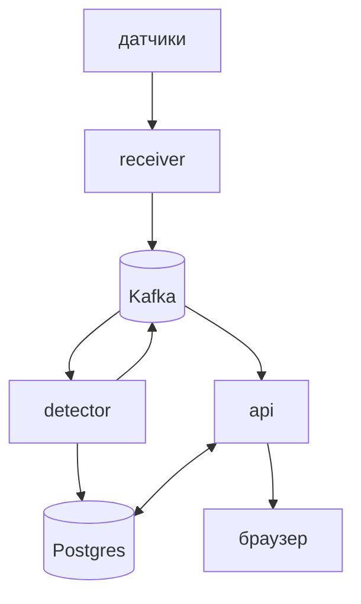

# streaming-hazard-monitor

Система мониторинга опасности на предприятиях. Датчики газа, дыма, температуры и радиации стоят в зданиях и раз в секунду шлют показания. Если значение выше порога, система поднимает тревогу и показывает все на мониторе.

Это пет-проект: я хотел на практике разобраться с Kafka, от producer и consumer до партиций, consumer groups и ребалансировки. Предметная область нужна для наглядности.

<!-- Здесь будет гифка монитора. -->

## Подход

Сначала я делал самое простое решение, гонял нагрузочный тест, пока оно не сломается, и потом чинил то, что сломалось. Так появились Kafka, запись пачками, кеш в памяти и защита от дребезга. Каждое изменение я сравнивал с предыдущим замером.

## Результаты

Все замеры сделаны на одной машине (Ryzen 7 8700G, 8 ядер / 16 потоков), генератор нагрузки k6 запущен на ней же. Подробности по каждому шагу - в [docs/load-testing.md](docs/load-testing.md).

| Замеры | Было | Стало | Изменения |
|---|---|---|---|
| Прием показаний, 1 воркер | 700 в секунду | 2750 в секунду | показание отправляется в Kafka, устройство ищется в словаре в памяти |
| Прием показаний, 8 воркеров | 2800 в секунду | не меньше 8800 в секунду | показание отправляется в Kafka, устройство ищется в словаре в памяти |
| LAG на одну партицию при шуме у порога за минуту | ~27 000 | ~65 | смены уровня пишутся пачками, одной транзакцией |
| Строк в `alerts` за минуту | ~30 500 | ~1250 | уровень меняется только после серии показаний подряд |

Система целиком держит 8000 показаний в секунду: отказов меньше 0,1%, отставание detectorа после прогона возвращается к нулю. На 10 000 ломается генератор нагрузки: k6 исчерпывает свободные порты, а сервисы при этом не загружены. Подробности и догон потока detectorом после простоя - в [docs/load-testing.md](docs/load-testing.md#шаг-8-вся-система-на-одной-машине).

## Архитектура



| Сервис | Роль |
|---|---|
| `receiver` | Принимает показания (`POST /receiver/telemetry/`) и кладет их в Kafka |
| `detector` | Определяет уровень опасности датчика и пишет алерты |
| `api` | API для фронта, раздает уровни и показания по WebSocket |
| `frontend` | Веб-интерфейс на React, страница "Монитор". Сделан с помощью ИИ, проект про бэкенд |
| `kafka`, `db` | Kafka и Postgres |

Данные разделены по предприятиям: у предприятия здания, у зданий датчики. Сотрудник видит только свое здание, директор - все здания своего предприятия, суперпользователь - все. Те же правила действуют для живых данных в сокете.

## Ключевые решения

- Receiver только проверяет ключ и отправляет показание в Kafka, `202` уходит после подтверждения брокера. Если брокер лежит, через 800 мс уходит `503`: датчик ждет ответа всего секунду.
- Ключи устройств лежат в памяти receiverа и перечитываются из базы раз в минуту. Поиск в Postgres на каждый запрос съедал больше половины воркера. Новый ключ начинает работать с задержкой до минуты, по памяти это 80 байт на устройство.
- Ключ сообщения в Kafka - `device_uuid`, порядок нужен только внутри датчика.
- Detector держит пороги и уровни в памяти и ходит в базу только при смене уровня.
- В Postgres только алерты. Алерт - отрезок времени, который датчик провел на одном уровне. Показания живут в Kafka.
- От дребезга сначала хотел окно из 60 показаний, потом заменил его счетчиком показаний подряд: 5 вверх, 15 вниз. На датчик хранится одно число. Тревога приходит через 4 секунды, а строк в `alerts` за минуту стало ~1250 вместо 30 500.
- Detector работает в нескольких экземплярах в одной consumer group. Получив партицию после ребалансировки, он загружает уровни ее датчиков из базы.
- Смена уровня сначала уходит в топик `device-levels`, потом в базу. В обратном порядке падение между шагами теряло событие, а повтор безвреден: дубль сообщает тот же уровень еще раз.
- Монитор получает данные по WebSocket, только по датчикам на экране и раз в секунду одним сообщением. Воркеры `api` читают топики без consumer group, потому что события нужны каждому воркеру.

## Стек

Python 3.14, FastAPI, aiokafka, SQLAlchemy 2.0 (asyncpg), Alembic, PostgreSQL 18, Apache Kafka 4, Docker Compose, GitHub Actions, k6.

## Запуск

Нужны Docker и Docker Compose.

1. Создать файл с настройками и поправить в нем значения:

   ```bash
   cp .env_example .env
   ```

2. Поднять сервисы:

   ```bash
   docker compose up -d --build
   ```

3. Применить миграции:

   ```bash
   docker compose exec api alembic upgrade head
   ```

4. Создать суперпользователя:

   ```bash
   docker compose exec api python -m scripts.createsuperuser
   ```

После этого доступны:

- фронт: http://localhost:5173
- API и его документация: http://localhost:8000/api/docs/
- прием показаний и его документация: http://localhost:8001/receiver/docs/
- Postgres: порт 5433

Создание тестовых датчиков и запуск нагрузки - в [docs/load-testing.md](docs/load-testing.md#запуск).

## Тесты и CI

Тестам нужен запущенный Postgres: на время прогона они создают отдельную базу и удаляют ее в конце. Kafka в тестах заменяется заглушками.

```bash
docker compose exec api pytest
```

На каждый pull request GitHub Actions параллельно запускает flake8, тесты на Postgres в контейнере и сборку образа. На push в `main` образ собирается и публикуется в GitHub Container Registry.

## Структура

```
api/          пользовательский API и WebSocket монитора
receiver/     прием показаний
detector/     обработка потока показаний
shared/       модели, схемы сообщений, настройки, общий код Kafka
migrations/   миграции Alembic
tests/        тесты, по доменам
scripts/      нагрузочный тест k6, тестовые датчики, создание суперпользователя
frontend/     веб-интерфейс
docs/         замеры по шагам
```

Все Python-сервисы собираются из одного Docker-образа с разными точками входа.

## Что дальше

- Переписать receiver на Go и сравнить загрузку процессора на той же нагрузке. Сейчас receiver ест больше всех.
- Уведомления о тревогах, либо о датчиках, которые перестали присылать показания.
